<h2>🎅Secret Santa</h2>
<p>This is a web application built around a Secret Santa theme event system created with <strong>ASP.NET Core MVC version 9.0.17!</strong> You can organize events, manage participants and randomly assign gift recipients. </p>

<h2>📖About the project</h2>
<p>Secret Santa is a web application designed to simplify the organization of gift exchanges. It lets you create events, invite participants, manage wishlist information and generate randomized assignments while respecting partner restrictions and previous rounds, so at the end of the day nobody gets mad when the draw sequence begins.</p>

<p>Participants can access the application through personal invitation links to view their assigned recipient, manage their own wishlist and view their recipient's wishlist. The reason behind this simple personal invitation link system is to let recipients join the events as guests - there is no need to register to participate in the event!</p>

<h2>✨Features✨</h2>
<h4>📋Event Management</h4>
<ul>
  <li>Create, view, edit and delete Events.</li>
  <li>Configure event details, including the date, budget and minimum number of participants.</li>
  <li>Restrict event management to the Organizer who created the event.</li>
</ul>

<h4>🫂 Participant Management</h4>
<ul>
  <li>Manage participants within the event.</li>
  <li>Configure partner restrictions to prevent certain participants (couples) from drawing each other.</li>
  <li>Generate personal invitation links for the participants.</li>
  <li>Revoke existing invitation links and generate replacements.</li>
</ul>

<h4>🎁Secret Santa Draw</h4>
<ul>
  <li>Randomly assign a recipient to each participant.</li>
  <li>Prevent participants from drawing themselves.</li>
  <li>Respect partner restrictions.</li>
  <li>Prevent participants from receiving the same recipient in previous rounds.</li>
  <li>Store assignments by event and round.</li>
  <li>Warn the Organizer when participants were added or removed after the last draw, so the draw can be repeated.</li>
</ul>

<h4>✍️Wishlists</h4>
<ul>
  <li>Create, edit and delete personal wishlist items.</li>
  <li>Add product titles, descriptions and product URLs.</li>
  <li>View the wishlist of the participant assigned to you.</li>
  <li>Restrict wishlist access according to the participant identity and draw assignments.</li>
</ul>

<h4>🔐Authentication and Security</h4>
<ul>
  <li>Organizer authentication using ASP.NET Core Identity.</li>
  <li>Separate cookie authentication for participants.</li>
  <li>Time-limited invitation links.</li>
  <li>Revocation and expiration checks for participant invitations.</li>
  <li>Server-side authorization checks for event and wishlist access.</li>
  <li>Antiforgery validation on all form submissions that change data, including the draw.</li>
  <li>Database constraints to help maintain data integrity.</li>
</ul>

<h2>🧰Technologies Used</h2>
<ul>
  <li>VS Code v1.140.0.</li>
  <li>HTML and CSS.</li>
  <li>Bootstrap 5</li>
  <li>DBeaver v26.0.4.</li>
  <li>Microsoft Entity Framework Core v9.0.17</li>
  <li>Microsoft SQL Server</li>
  <li>ASP.NET Core MVC v9.0.17</li>
  <li>ASP.NET Core Identity v9.0.17</li>
</ul>

<h2>Getting Started</h2>
<h3><strong>Prerequisites</strong></h3>
<p>Before running the application, make sure you have:</p>
<ul>
  <li>The .NET SDK version 9.0</li>
  <li>Microsoft SQL Server</li>
  <li>An IDE or code editor, such as Visual Studio, VS Code or JetBrains Rider</li>
  <li>Git (optional, for cloning the repository)</li>
</ul>
<h3><strong>1. Clone the repository</strong></h3>

```bash
git clone https://github.com/vnvladimirov/SecretSantaWIP
cd SecretSantaWIP
```

<h3><strong>2. Configure the database connection</strong></h3>
<p>The connection string in <code>appsettings.json</code> only contains a placeholder password, so your real password never ends up in Git. Store your own connection string with <strong>.NET User Secrets</strong> (the project already has a <code>UserSecretsId</code>):</p>

```bash
cd SecretSanta
dotnet user-secrets set "ConnectionStrings:DefaultConnection" "Server=localhost,1433;Database=SecretSanta;User Id=sa;Password=YOUR_PASSWORD_HERE;TrustServerCertificate=True;"
```
<p>The database and the web application are developed in <strong>DBeaver</strong> and <strong>VS Code</strong> on <strong>Linux Mint (Ubuntu 24.04 base)</strong>, so the authentication for the SQL Server is <strong>SQL Server Authentication!</strong></p>

<h3>3. Restore dependencies</h3>

```bash
dotnet restore
```

<h3>4. Run the application!</h3>
<p>Run it from the <code>SecretSanta</code> project folder. The database migrations are applied automatically on startup.</p>

```bash
cd SecretSanta
dotnet run
```

<h3>5. User authorization</h3>
<p>When the application runs in the <strong>Development</strong> environment against an empty database, it creates a completely fictional demo organizer and a sample event so you can try everything right away:</p>
<h4><strong>Username: michael.scott@gmail.com</strong></h4>
<h4><strong>Password: 123Michael123!</strong></h4>
<p>This account is only created in Development. You can also register your own organizer account.</p>

<h2>📁 Project Structure</h2>
<p>The project follows the <strong>ASP.NET Core MVC</strong> architecture</p>

<h3>Project Hierarchy</h3>
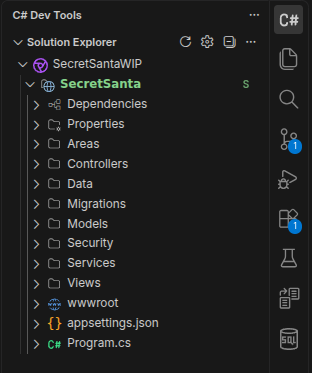
<h3>Controllers</h3>
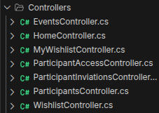
<h3>Data</h3>
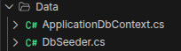
<h3>Project Models</h3>
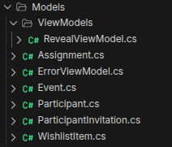
<h3>Views</h3>
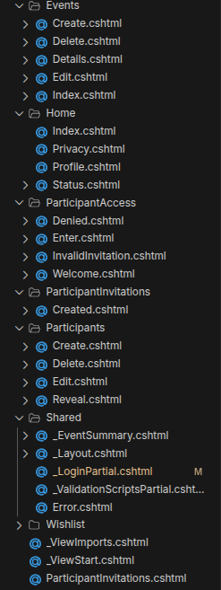

<h2>🔄 How it Works</h2>
<p>Here is the <strong>step by step</strong> guide for the Organizer</p>

<ol>
  <li>The Organizer registers or signs in.
    <p align="center">
      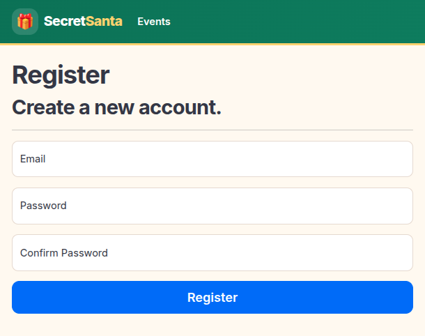
      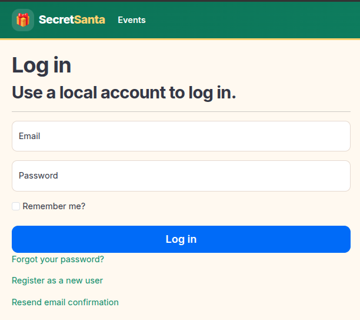
    </p>
  </li>
  <li>The Organizer creates a new event from the "Create new event" button.
    <p align="center">
      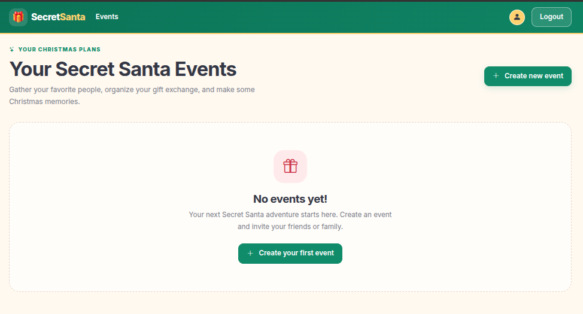
    </p>
  </li>
  <li>The Organizer fills in the form with the event Name, Description, Budget, Event Date, Minimum Participants and their own Name and Email.
    <p align="center">
      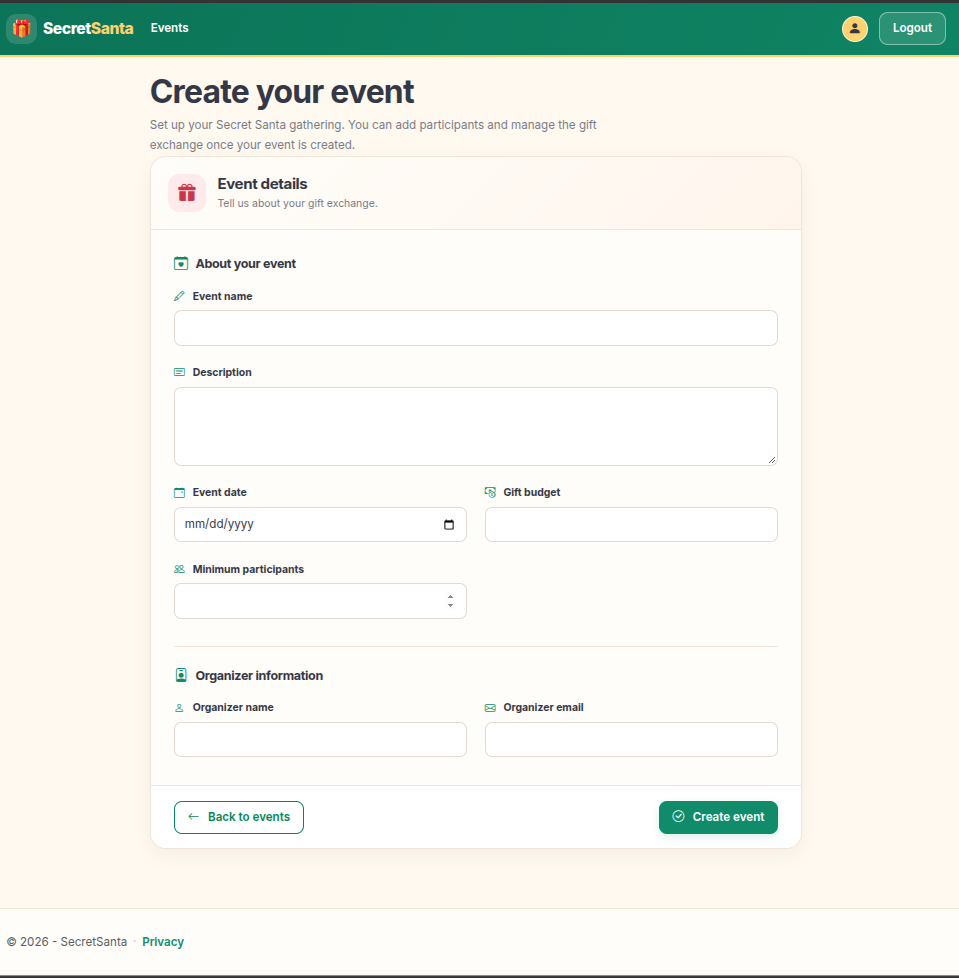
    </p>
  </li>
  <li>The Organizer can add new participants to the event.
    <p align="center">
      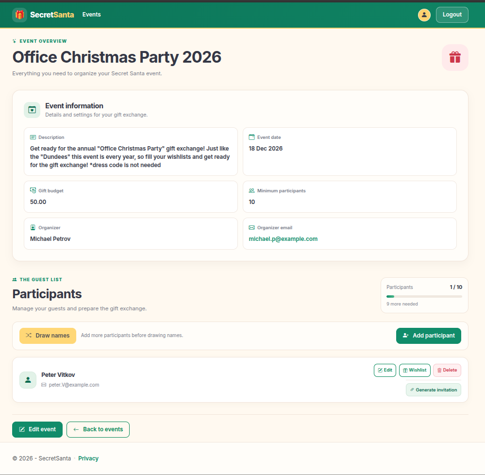
      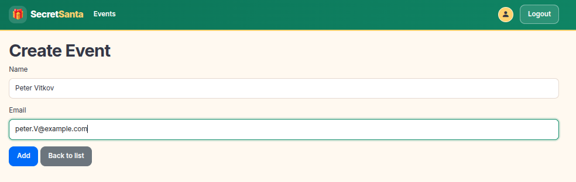
    </p>
  </li>
  <li>The Organizer can edit participants in the event and also assign their partners (couples).</li>
  <li>The Organizer can delete participants from the event.</li>
  <li>The Organizer can draw the names by clicking the "Draw names" button and confirming. If participants are added or removed afterwards, the event page shows a warning and the Organizer can use "Draw again" to start a new round.</li>
  <li>After the drawing the Organizer can generate a unique invitation link and send it to each participant!</li>
  <li>Participants use their links to enter the application and manage their wishlists.</li>
  <li>Each participant can view their assigned recipient and that recipient's wishlist.</li>
</ol>

<h2>🔐Security Notes</h2>
<ul>
  <li>Participant invitation tokens are generated using cryptographically secure random bytes.</li>
  <li>Invitation tokens are stored as hashes rather than in plaintext.</li>
  <li>Participant sessions use a separate authentication cookie.</li>
  <li>Invitation expiration and revocation are checked during participant authentication.</li>
  <li>Server-side checks restrict access to event data and wishlist items.</li>
  <li>Database passwords are kept out of the repository (use User Secrets locally).</li>
</ul>

<h2>🪳Bugs and Future features</h2>
<p>There are still new features to be added and probably some bugs along the way! If you encounter bugs feel free to give feedback or squash them!</p>
<p>This project is entirely open-sourced and there is no License, so feel free to use it, modify it and have fun with it!</p>
